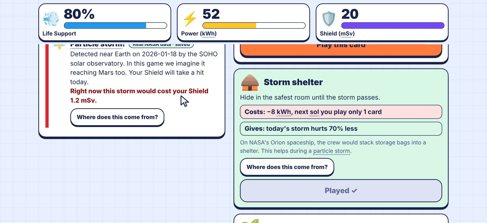

# Outpost 30 — Junior Astronaut Mission Trainer

**▶ Play:** https://shozy-frenia.github.io/junior-astronaut-trainer/

**▶ Watch:** [30-second demo](media/demo-30s.mp4) (English subtitles: [media/demo-30s.en.srt](media/demo-30s.en.srt))

Outpost 30 is a browser card game for kids aged 7–12, built for the NASA Space Apps Challenge "Build a Junior Astronaut Mission Trainer". You and a crewmate run a small base at Jezero crater on Mars for 30 sols (Mars days). Every sol you pick 2 of 3 cards, and every card costs something: making oxygen drains power, building a radiation shield costs water, and hiding from a storm costs you a turn. You balance three bars (Life Support, Power and Shield) while the game replays **real NASA space weather**: solar flares, CMEs and particle storms from NASA's DONKI database. When the browser is online it fetches the last 30 days from NASA live; when it is offline it uses an embedded archive and clearly says so. Every real fact in the game has a "Where does this come from?" button that links to its NASA or CSA source. At the end, a debrief replays your mission to show which 3 choices mattered most.

## How to play

1. Open the game (link above, or open `index.html` in any browser; it works offline).
2. **Pick your rank.** 🧑‍🚀 Cadet is for first missions: air lasts longer. 🚀 Commander is the full challenge.
3. **Read the morning report.** It shows today's real space weather, dust storms and broken machines.
4. **Pick 2 of your 3 cards.** No skipping, and no card is free.
5. **Press sunset.** The base uses air, power and Shield, then the next sol starts.
6. **Win:** reach sol 30 with all three bars above 0, plus ⭐ 3 science stars and 🌱 5 harvests. Keep at least 4 mSv of Shield for 3 stars.

New players get a 4-step mission briefing (How to play brings it back). Sound effects are off until you turn them on. Younger players can press Listen to hear Kip and the morning report read aloud (the browser's own voice, works offline). At the end, "For teachers and parents" gives a class link so everyone plays the same mission. The base is alive: an animated scene shows today's storms, flares, dust and breakdowns, and everything you built. A short sunset between sols shows what the base used overnight. After the mission, the debrief shows a sol-by-sol chart of your three bars, replays your game to find the 3 choices that mattered most, and compares your radiation dose with real Mars and space station measurements.

Tips: tap any dotted word (sol, mSv, CME...) for a one-sentence explanation. Kip, your guide, gives hints. For a class or a demo, add `?seed=131&level=cadet&archive=1` to the URL: everyone plays the same saved mission (this one opens on a real X1.9 flare and a storm NASA's SOHO observatory detected on 18 January 2026).

Files: `index.html` (game engine and UI), `data.js` (all real data, each value with source URL and retrieval date), `style.css`, `SOURCES.md` (full source notes and caveats), `tools/` (test and balance simulators, run with Node). Plain HTML/CSS/JS, no build step, no accounts.

## Tested: every choice costs something

`tools/balance.js` plays the real game engine 1,000 times per strategy on the same seeds. The bots see only what a player sees. No one-card habit wins, so there is no free safe choice.

| Strategy | Cadet wins | Commander wins |
|---|---|---|
| Smart planner | 88.2% | 63.3% |
| Random cards | 25.6% | 3.2% |
| Always shield | 21.8% | 2.1% |
| Always save power | 12.7% | 0.5% |
| Always science | 6.6% | 0.0% |

Run it: `node tools/balance.js index.html data.js --level cadet` (or `commander`). `node tools/sim.js index.html data.js` checks the rules, the data and that the same seed always gives the same game.

## Datasets used

All saved data was retrieved on **2026-11-14** and is an archive, not live. Only the DONKI space weather can be fetched live, and the game labels which one you are seeing. Card costs, power numbers and chances are game numbers, not real measurements. See [SOURCES.md](SOURCES.md) for details and caveats.

| Dataset | Used for |
|---|---|
| [NASA CCMC DONKI](https://ccmc.gsfc.nasa.gov/DONKI-API/) | Solar flares, CMEs and particle storms (live or archived 2025-11-15 to 2026-11-14) |
| [NASA JPL Horizons](https://ssd.jpl.nasa.gov/api/horizons.api) | Earth–Mars radio delay on the Call Earth card |
| Curiosity RAD radiation on Mars ([SwRI release](https://swri.org/node/9079), [2017 storm](https://www.swri.org/newsroom/press-releases/large-solar-storm-sparks-global-aurora-doubles-radiation-levels-mars)) | Daily dose of 0.67 mSv per sol, Forbush dip, debrief comparison |
| [NASA OSDR RadLab](https://visualization.osdr.nasa.gov/radlab/) | ISS astronaut dose for the debrief comparison |
| [Perseverance MEDA weather](https://www.nasa.gov/directorates/stmd/nasas-first-weather-report-from-jezero-crater-on-mars/) | Real Jezero day and night temperatures on the start screen |
| [NASA OSDR](https://osdr.nasa.gov/bio/repo/data/studies/OSD-342) (OSD-342, OSD-684, OSD-530, Inspiration4 OSD-569/570/571/575) and [Barger et al. 2014](https://pmc.ncbi.nlm.nih.gov/articles/PMC4188436) | Real astronaut-health facts on the Lab experiment card and in the debrief |
| [Mars Fact Sheet](https://nssdc.gsfc.nasa.gov/planetary/factsheet/marsfact.html), [Earth Fact Sheet](https://nssdc.gsfc.nasa.gov/planetary/factsheet/earthfact.html) | Sol length; Mars sunlight (about 43% of Earth's) behind the solar power numbers |
| [NASA MOXIE](https://www.nasa.gov/missions/mars-2020-perseverance/perseverance-rover/nasas-oxygen-generating-experiment-moxie-completes-mars-mission/) | MOXIE oxygen maker card |
| [ISS water recovery](https://www.nasa.gov/missions/station/iss-research/nasa-achieves-water-recovery-milestone-on-international-space-station/) | Recycler overtime card, broken recycler |
| [Opportunity](https://www.jpl.nasa.gov/edu/resources/teachable-moment/mars-rover-mission-comes-to-an-end-but-science-legacy-live-on/), [InSight](https://www.jpl.nasa.gov/news/nasas-insight-still-hunting-marsquakes-as-power-levels-diminish/) | Dust storm event, Clean solar panels card, broken solar string |
| [Solar conjunction 2026 (NASA MAVEN blog)](https://science.nasa.gov/blogs/maven/2025/12/23/nasa-works-maven-spacecraft-issue-ahead-of-solar-conjunction/) | "Mars is behind the Sun" event that blocks Call Earth |
| [CSA: Growing food in space](https://www.asc-csa.gc.ca/eng/sciences/food-production/growing-healthy-food-in-space-and-remote-areas.asp), [CSA Interplanetary Farming (PDF)](https://www.asc-csa.gc.ca/pdf/eng/youth-educators/activities/fitness-and-nutrition/interplanetary-farming.pdf) | Grow food card |
| [Mars Ice Home](https://www.nasa.gov/centers-and-facilities/langley/nasalangley100-sojourning-to-mars/), [regolith shielding](https://ntrs.nasa.gov/citations/19900062325), [Orion storm shelter](https://science.nasa.gov/science-research/heliophysics/how-nasa-will-protect-astronauts-from-space-radiation-at-the-moon/), [Perseverance sample tubes](https://science.nasa.gov/photojournal/the-33-sample-tubes-collected-by-perseverance/), [ISS 3D printer](https://www.nasa.gov/missions/station/open-for-business-3-d-printer-creates-first-object-in-space-on-international-space-station) | Water wall, Dirt roof, Storm shelter, Rock-sample walk and Fix-it cards |

The in-game **Data sources** screen (footer link) lists every dataset and link.

## AI disclosure

This project was built with AI assistance: Anthropic Claude helped write the code (game engine, interface, animations, test tools), drew the Kip robot and the Mars base scene as code (SVG), and drafted text, the README, the slides and the demo video's subtitles. The demo video is a real screen recording of the game, edited with code, and carries an "AI-assisted" mark. No NASA logos, flags or mission identifiers are used or changed. Every real number in `data.js` was taken from the cited NASA or CSA page and keeps its source URL and retrieval date; game numbers are marked as game numbers.

## Team

**Nabeghlavi** (solo entry).

## License

Code: [MIT](LICENSE) © 2026 Nabeghlavi. NASA and CSA data and linked pages belong to their owners and follow their own terms; the game links to each source. Fonts: Fredoka and Nunito, embedded in style.css under the SIL Open Font License ([fonts/OFL.txt](fonts/OFL.txt)). Icons are drawn as SVG code in index.html.
